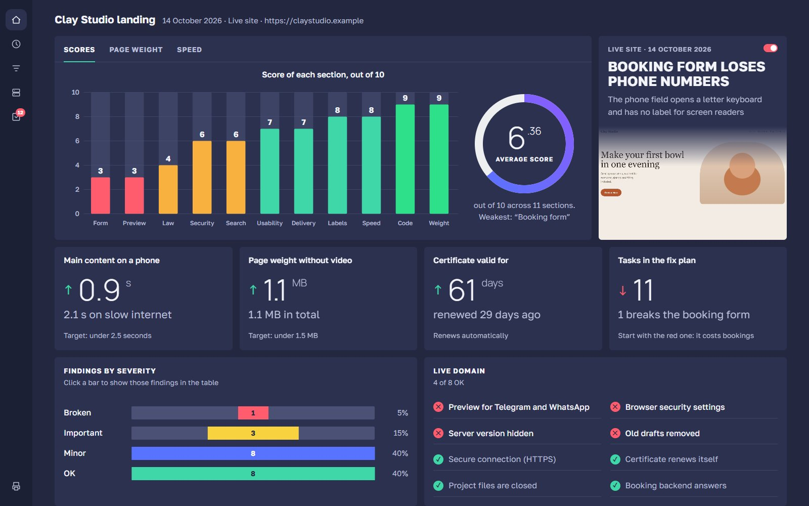

# site-audit

**Audit a website from the outside, the way a visitor sees it, and get an interactive dashboard with a
score for every part of the site.** Read-only: no forms, no logins, no attacks. Every number comes from
bundled scripts, not from the model's guess.



## The problem

Ask an AI agent to "check my site" and you get a list of best practices that may or may not apply,
numbers estimated by eye, and a wall of jargon. For someone who built a landing page with AI and is about
to launch it, that answers the wrong questions. What they need to know: will it break for visitors, will
it leak anything, will the link look right in Telegram, is it fast, is it legal.

## The solution

```
Inputs and mode → 4 measuring scripts → analysis against thresholds → report.md + audit.json → dashboard.html (opens itself)
```

1. **Scripts measure, the model judges.** Four Python scripts collect everything a visitor's browser and
   a polite crawler can see: page weight, speed in three device profiles (median of three runs), server
   headers, certificate, robots.txt, exposed files, link previews, accessibility. The model reads the
   JSON, compares it with explicit thresholds and writes findings with evidence.
2. **Safe by construction.** GET and HEAD only, one request per second on a live site. The browser
   scripts abort any non-GET request. Service-file probes read 256 bytes, check a signature and never
   store the body. A found key is never tested.
3. **Pre-deploy mode.** The page can still be on `localhost`. It is measured locally while the server
   checks run on the domain it will move to. It also checks that the backend the page calls is actually
   deployed there, which is the most common way an AI-built landing breaks on launch day.
4. **A dashboard for the owner, a report for whoever fixes it.** `dashboard.html` is one file: scores per
   section, key numbers, findings by severity, live-domain checks, a sortable table of findings with
   "done" ticks. `report.md` has the evidence, effort estimates and a work plan.

## What it checks

| Block | Examples |
|---|---|
| Weight and delivery | first screen / without video / video split, compression, cache lifetime, image sizes vs display, fonts |
| Speed | FCP, LCP, CLS (session windows), TBT, lab INP via safe clicks; server TTFB broken into DNS / connect / TLS / wait |
| Video | poster, preload, `muted playsinline`, bytes before scroll, bitrate via `ffprobe` |
| Security, observation only | HTTPS and certificate chain, security headers on HTML / redirect / 404 / static, exposed `.git` / `.env` / drafts / agent notes (with a false-200 fingerprint), secrets in client code, compromised CDNs, bare IP, crt.sh |
| Indexing | robots.txt (incl. AI bots and Yandex `Clean-param`), sitemap, draft leftovers (`noindex`, canonical to a test domain), duplicate URLs, real 404 |
| Link previews | Open Graph tags, `og:image` size and weight, answers to TelegramBot / WhatsApp / VK crawlers |
| Accessibility | axe-core, zoom blocking, reflow at 320 px and with text ×2, touch targets (24 / 44 px), keyboard focus pass, reduced motion, form field names and keyboards, no-JS view |
| Code quality | coverage in KB (not misleading %), leftovers, design-token spread |
| Law (Russia) | privacy policy and separate consent, seller details, offer and refund wording, foreign services, ad labelling — as signals for a lawyer, not verdicts |

## Install

```bash
cp -r site-audit/ ~/.claude/skills/site-audit/
pip install playwright pillow dnspython
```

Needs Python 3.10+ and Google Chrome (the browser scripts use Playwright with `channel="chrome"`).
Optional: `ffprobe` for video bitrates.

## Usage

- "Audit my site https://example.com"
- "Check this landing before launch — it's on localhost:8080, going to example.com"
- "Why is my site slow on phones?"
- «Проверь сайт», «проверь лендинг перед выкладкой»

Try the dashboard without auditing anything:

```bash
python ~/.claude/skills/site-audit/scripts/build_dashboard.py ~/.claude/skills/site-audit/assets/example-audit.json demo.html
```

The dashboard speaks English or Russian (`"lang"` in `audit.json`); the report follows the user's language.

## Layout

```
site-audit/
├── SKILL.md                 ← workflow, safety rules, common mistakes
├── scripts/
│   ├── static_audit.py      ← raw HTML and every referenced file
│   ├── render_audit.py      ← Chrome: profiles, medians, weight, video, coverage
│   ├── a11y_audit.py        ← axe-core, keyboard, zoom, reflow, reduced motion
│   ├── server_audit.py      ← live domain: TLS, headers, robots, probes, previews, TTFB
│   ├── build_dashboard.py   ← validates audit.json, builds and opens dashboard.html
│   └── vendor/axe.min.js    ← axe-core 4.10.2
├── assets/
│   ├── dashboard.html       ← dashboard template
│   ├── example-audit.json   ← sample data (fictional pottery studio)
│   └── example-screenshot.jpg
└── references/
    ├── checks.md            ← what to check per block, which JSON field holds it
    ├── thresholds.md        ← good / warning / problem, severity scale
    ├── law-ru.md            ← legal signals for sites in Russia
    └── report.md            ← report template and dashboard data schema
```

## What it will not do

- **Audit someone else's site without permission.** It asks first: probing service paths on a site you
  do not own is a grey zone.
- **Pentest.** No payloads, no logins, no form submits, no port scans. Anything that needs active testing
  is marked "confirmed only by a pentest".
- **Read your source code.** It is black-box on purpose; use a code review for the inside.
- **Give legal verdicts.** Legal items are signals with a reference to the norm; dates and fines must be
  checked against the current law.
- **Replace field data.** Speed numbers are lab measurements from one machine. PageSpeed / CrUX field
  data can be added when the site has enough traffic, and most small sites do not.

## Credits

Started from a black-box audit prompt shared in a Telegram chat in October 2026. It was rebuilt after a
real run, then reviewed by five specialist agents (security, search, performance, accessibility,
Russian law), and checked against deliberately broken pages before release.

Bundles [axe-core](https://github.com/dequelabs/axe-core) by Deque Systems, under the Mozilla Public
License 2.0 (see the header of `scripts/vendor/axe.min.js`). Everything else in this folder is MIT.

---

🇷🇺 Проверка сайта снаружи, как его видит посетитель: скорость, вес, защита, открытые файлы, поисковики,
превью ссылки в Telegram, доступность, базовые требования закона РФ. Только чтение, цифры считают
программы. Работает и до выкладки: страница локально, сервер на будущем домене. Результат — наглядная
панель с оценкой каждого раздела от 1 до 10 и подробный отчёт с планом работ.
